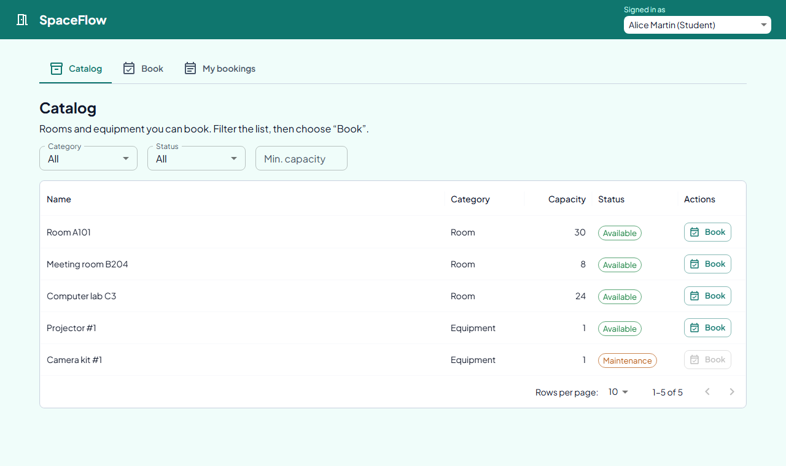
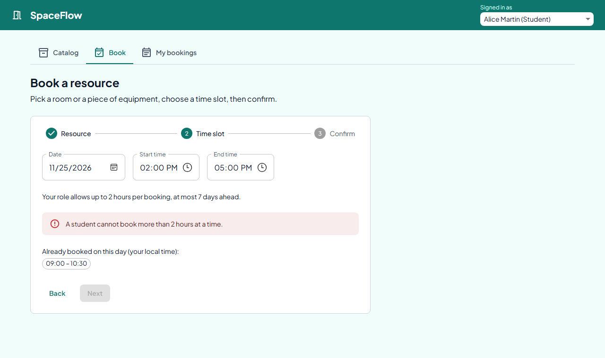
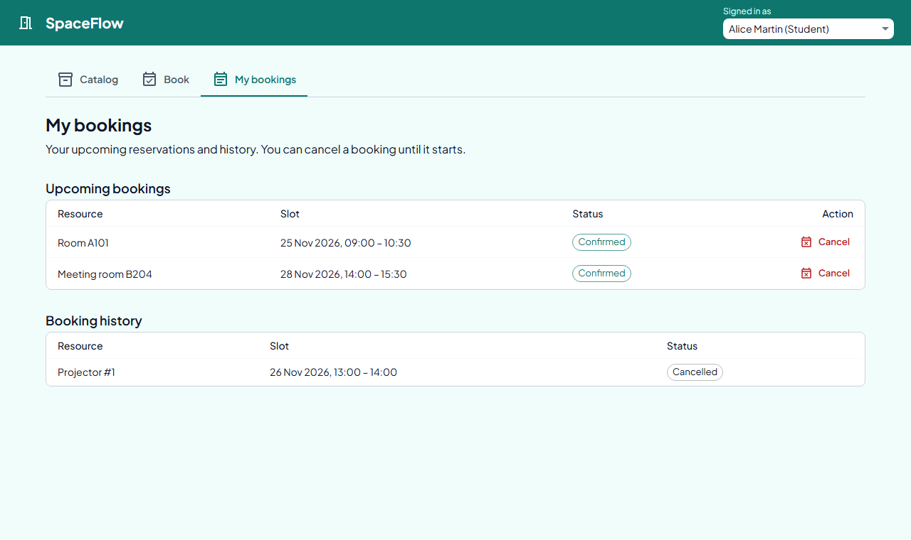
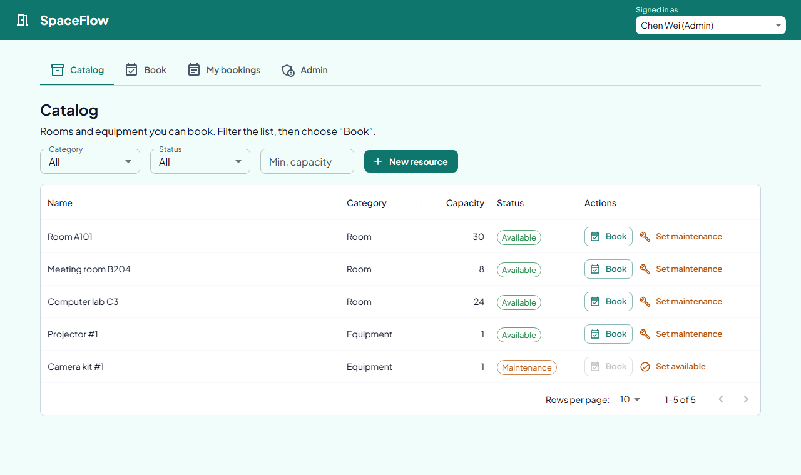
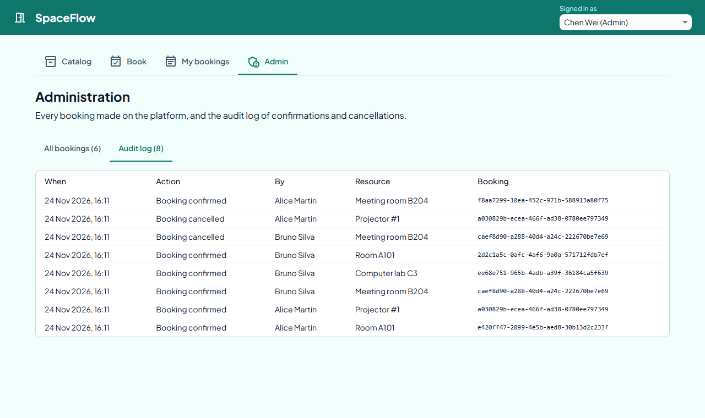
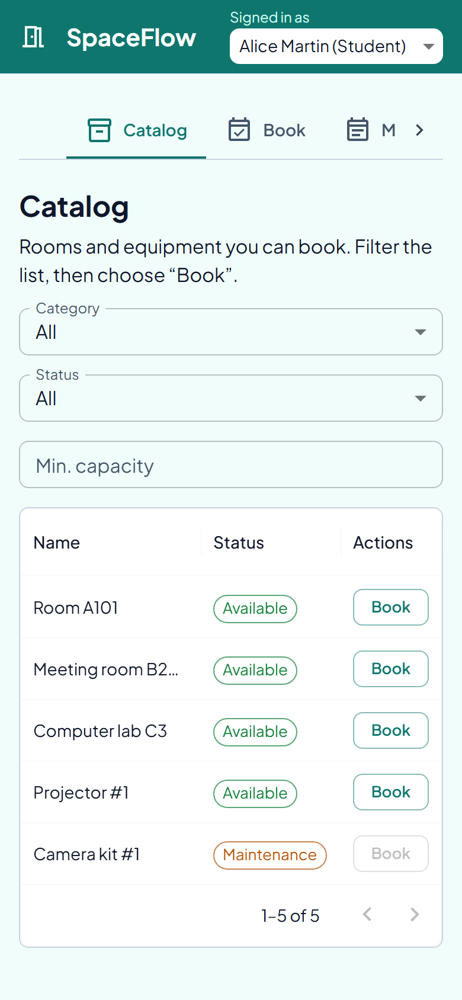
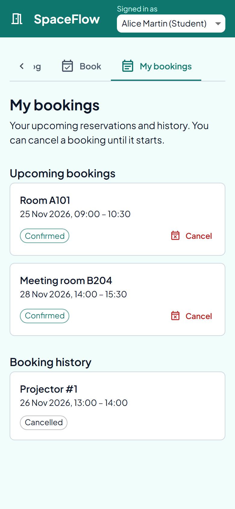
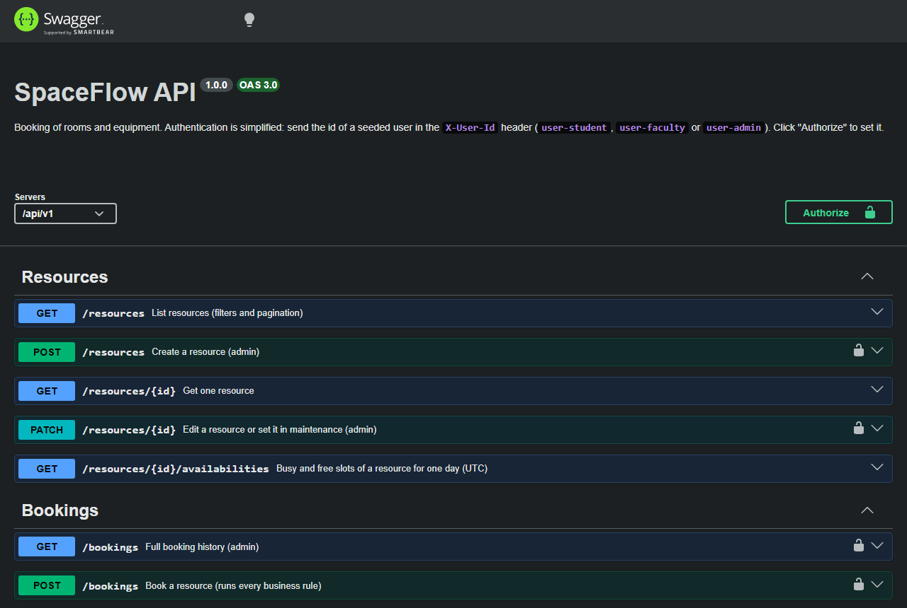
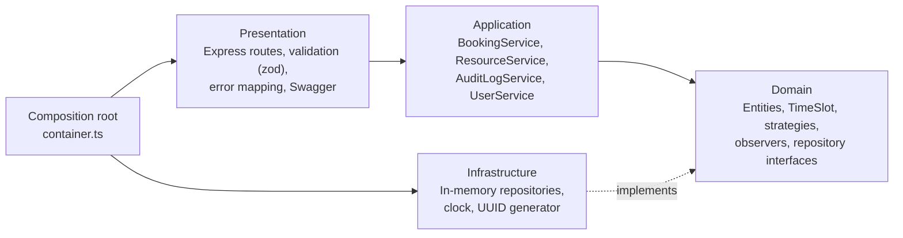

# SpaceFlow

[](https://github.com/zeynab-belkasmi/SpaceFlow/actions/workflows/ci.yml)


**SpaceFlow is a booking platform for shared rooms and equipment on a campus.** Students and faculty book a meeting room, a lab or a projector, and the platform enforces the rules for each role: how long you can book, how many bookings you can hold at once and how far ahead you can book. Administrators manage the catalogue, put resources into maintenance and review an audit log of every booking event.

The project is a full-stack TypeScript application (Express API + React client). It shows **Clean Architecture**, **SOLID** principles and four design patterns (**Strategy**, **Repository**, **Observer**, **Value Object**), with test-driven development and 100% test coverage of the business core.



## Table of Contents

- [Features](#features)
- [Screenshots](#screenshots)
- [Installation](#installation)
- [Usage](#usage)
- [Business Rules](#business-rules)
- [Architecture](#architecture)
- [API Reference](#api-reference)
- [Testing](#testing)
- [Technologies Used](#technologies-used)
- [Project Structure](#project-structure)
- [Contributing](#contributing)
- [License](#license)

## Features

**For every user**

- **Resource catalogue**: browse rooms and equipment and filter by category, status and minimum capacity, with server-side pagination.
- **Step-by-step booking**: choose a resource, then a time slot, then confirm. The form checks your role's limits while you type and shows the slots already taken that day.
- **Conflict detection**: two bookings can never overlap on the same resource (`409 Conflict`).
- **Role quotas**: duration, number of active bookings and booking window depend on your role (`422 Unprocessable Entity`).
- **My bookings**: upcoming bookings and history in one place, with one-click cancellation.

**For administrators**

- Create and edit resources, and **set a resource to maintenance** to block new bookings.
- See the **full booking history** and the **audit log** of every confirmation and cancellation.

**Quality**

- Interactive API documentation (Swagger UI / OpenAPI 3.0).
- Accessible UI (WCAG AA contrast, keyboard navigation, screen reader labels) that works on phones.
- Every API error uses the same JSON format.

## Screenshots

|                                       Booking with live validation                                       |                                           My bookings                                            |
| :------------------------------------------------------------------------------------------------------: | :----------------------------------------------------------------------------------------------: |
|       |  |
|                                     **Admin: catalogue management**                                      |                                       **Admin: audit log**                                       |
|  |        |

<table>
  <tr>
    <th>Mobile: catalogue</th>
    <th>Mobile: my bookings</th>
    <th>Interactive API docs</th>
  </tr>
  <tr>
    <td width="25%"></td>
    <td width="25%"></td>
    <td width="50%"></td>
  </tr>
</table>

## Installation

**Prerequisites:** [Node.js](https://nodejs.org/) 22.12 or later, and npm 10 or later.

1. **Clone the repository**

   ```bash
   git clone https://github.com/zeynab-belkasmi/SpaceFlow.git
   ```

2. **Go to the project folder**

   ```bash
   cd SpaceFlow
   ```

3. **Install the dependencies** (one command for the backend and the frontend, thanks to npm workspaces)

   ```bash
   npm install
   ```

4. **Start the app**: one command starts the API and the web client together

   ```bash
   npm run dev
   ```

   Then open **http://localhost:5173** for the web client. The API runs on http://localhost:3000. Logs are prefixed `[api]` and `[web]`, and Ctrl+C stops both. To run one side only, use `npm run dev -w backend` or `npm run dev -w frontend`.

   No database or `.env` file is needed: data is stored in memory and seeded on startup. In development, the frontend forwards `/api` calls to the backend through a Vite proxy.

**Production build**

```bash
npm run build                # compiles the backend (dist/) and bundles the frontend
npm start -w backend         # serves the API from the compiled code
npm run preview -w frontend  # serves the built frontend on http://localhost:4173
```

## Usage

Open **http://localhost:5173** and pick a user in the **Signed in as** menu, top right. Login is deliberately simplified (see [Authentication](#authentication)), and three users are seeded:

| User         | Role      | What to try                                                                                 |
| :----------- | :-------- | :------------------------------------------------------------------------------------------ |
| Alice Martin | `STUDENT` | Book a room for 3 hours and see the quota error appear live. Book 1 hour, then cancel it.   |
| Bruno Silva  | `FACULTY` | Book the same slot as Alice and get a conflict. Book a full afternoon (up to 8 hours).      |
| Chen Wei     | `ADMIN`   | Set a room to maintenance, create a resource, open the **Admin** tab to read the audit log. |

The catalogue starts with five resources, one of them (_Camera kit #1_) in maintenance.

### Using the API directly

The interactive documentation is at **http://localhost:3000/api-docs**. Click **Authorize** and enter a user id (`user-student`, `user-faculty` or `user-admin`).

```bash
# List the available rooms
curl "http://localhost:3000/api/v1/resources?category=ROOM&status=AVAILABLE"

# Book a room as the student
curl -X POST http://localhost:3000/api/v1/bookings \
  -H "X-User-Id: user-student" \
  -H "Content-Type: application/json" \
  -d '{"resourceId": "room-a101", "start": "2026-12-01T10:00:00Z", "end": "2026-12-01T11:00:00Z"}'
```

A refused request returns the uniform error format:

```json
{
  "status": "error",
  "code": "QUOTA_EXCEEDED",
  "message": "A student cannot book more than 2 hours at a time.",
  "timestamp": "2026-11-24T14:30:00.000Z"
}
```

### Authentication

There is no password: the client sends the id of a seeded user in the `X-User-Id` header, and the web client sets it from the **Signed in as** menu. The check sits in a single Express middleware, so it can be swapped for real JWT authentication without touching the routes or the business code.

## Business Rules

| Role      | Max duration per booking | Max active bookings | Book at most  |
| :-------- | :----------------------: | :-----------------: | :-----------: |
| `STUDENT` |         2 hours          |          2          | 7 days ahead  |
| `FACULTY` |         8 hours          |          5          | 30 days ahead |
| `ADMIN`   |         8 hours          |          5          | 30 days ahead |

- Two bookings on the same resource cannot overlap. Slots are half-open intervals `[start, end)`, so a booking may start exactly when the previous one ends.
- A booking cannot start in the past, and a resource in maintenance cannot be booked.
- A booking can be cancelled by its owner or an admin, but only before it starts.
- An _active_ booking is a confirmed one that has not ended yet.
- Every confirmation and cancellation is written to the audit log.

## Architecture

The backend follows **Clean Architecture**: dependencies point inwards, so the business rules (domain) know nothing about Express, HTTP or storage.



| Pattern          | Where                                                                      | Why                                                                                                                                 |
| :--------------- | :------------------------------------------------------------------------- | :---------------------------------------------------------------------------------------------------------------------------------- |
| **Value Object** | `TimeSlot`                                                                 | An always-valid, immutable time interval that is compared by value and owns the overlap logic.                                      |
| **Strategy**     | `StudentBookingStrategy`, `FacultyBookingStrategy`, `BookingPolicyFactory` | Quotas change by role without `if/else` chains. A new role means a new class (Open/Closed).                                         |
| **Repository**   | `IBookingRepository` and `InMemoryBookingRepository`                       | The domain declares what it needs and infrastructure decides how. Moving to Prisma/PostgreSQL only means changing `container.ts`.   |
| **Observer**     | `BookingEventPublisher`, `AuditLogObserver`                                | The booking service publishes events without knowing who listens. Adding an email notification means subscribing one more observer. |

Other choices worth knowing:

- **Time and ids are injected** (`IClock`, `IIdGenerator`), so every time-based rule is tested deterministically.
- **Domain errors carry a code, not an HTTP status.** The presentation layer maps `SLOT_CONFLICT` to 409, `QUOTA_EXCEEDED` to 422, and so on.
- **Repositories store copies**, like a real database, so a forgotten `save()` fails in tests instead of in production.
- On the frontend, an **Axios interceptor** adds the auth header and turns every failure into a typed `ApiError`, and the client checks the quotas for instant feedback. The server stays the source of truth.
- **Code splitting**: each page is loaded on demand (`React.lazy`), and React, MUI and the DataGrid are split into separate vendor files that browsers keep cached across releases.

Every significant choice, with the alternatives considered and the trade-offs, is recorded in the [decision log](docs/decision-log.md).

## API Reference

Base URL: `http://localhost:3000/api/v1`. The full, interactive specification is at `/api-docs`, and the raw document at `/api-docs.json`.

| Method  | Endpoint                                        | Access         | Description                                                                                   | Responses               |
| :------ | :---------------------------------------------- | :------------- | :-------------------------------------------------------------------------------------------- | :---------------------- |
| `GET`   | `/resources`                                    | Public         | List resources (filters: `category`, `status`, `minCapacity`; pagination: `page`, `pageSize`) | 200, 400                |
| `GET`   | `/resources/:id`                                | Public         | Get one resource                                                                              | 200, 404                |
| `GET`   | `/resources/:id/availabilities?date=YYYY-MM-DD` | Public         | Busy and free slots of a resource for one day (UTC)                                           | 200, 400, 404           |
| `POST`  | `/resources`                                    | Admin          | Create a resource                                                                             | 201, 400, 403, 422      |
| `PATCH` | `/resources/:id`                                | Admin          | Edit a resource or set its status                                                             | 200, 400, 403, 404, 422 |
| `POST`  | `/bookings`                                     | User           | Book a resource (runs every business rule)                                                    | 201, 400, 404, 409, 422 |
| `GET`   | `/bookings/me`                                  | User           | My bookings                                                                                   | 200                     |
| `GET`   | `/bookings`                                     | Admin          | Full booking history                                                                          | 200, 403                |
| `PATCH` | `/bookings/:id/cancel`                          | Owner or admin | Cancel a booking                                                                              | 200, 400, 403, 404      |
| `GET`   | `/audit-logs`                                   | Admin          | Audit log, most recent first                                                                  | 200, 403                |
| `GET`   | `/users`                                        | Public         | Seeded users (for the user picker)                                                            | 200                     |

Requests marked _User_, _Owner_ or _Admin_ need the `X-User-Id` header, and answer `401` without it.

## Testing

```bash
npm test                 # every test suite (backend + frontend)
npm run test:coverage    # with coverage reports
```

| Suite               | Tools                        | Content                                                                                                              |
| :------------------ | :--------------------------- | :------------------------------------------------------------------------------------------------------------------- |
| Backend unit        | Jest                         | Domain (value object, entities, strategies, observers) and application services, with Jest mocks of the repositories |
| Backend integration | Jest                         | Real services and in-memory repositories wired by the container                                                      |
| API end-to-end      | Jest + Supertest             | Real HTTP requests: 409 on conflicts, 422 on quotas, 403 for non-admins, error format…                               |
| Frontend            | Jest + React Testing Library | Components queried by role and label as a user would, plus the API client and validation rules                       |

**227 tests** in total (190 backend, 37 frontend). Coverage of `domain/` and `application/` is **100%**, and CI fails if it drops below the required 85%.

## Technologies Used

| Area        | Stack                                                                              |
| :---------- | :--------------------------------------------------------------------------------- |
| Backend     | Node.js, Express 5, TypeScript, zod (validation), swagger-ui-express (OpenAPI 3.0) |
| Frontend    | React 18, Material UI 9 and MUI X DataGrid, Axios, Vite                            |
| Tests       | Jest, Supertest, React Testing Library, SWC                                        |
| Quality     | ESLint (typescript-eslint, react-hooks), Prettier, Husky + lint-staged             |
| CI          | GitHub Actions: format, lint, typecheck, tests with coverage, build                |
| Persistence | In memory, behind repository interfaces, ready for Prisma / PostgreSQL             |

## Project Structure

```
SpaceFlow/
├── backend/
│   ├── src/
│   │   ├── domain/          # entities, value objects, strategies, observers, repository interfaces
│   │   ├── application/     # use cases (services)
│   │   ├── infrastructure/  # in-memory repositories, clock, id generator, seed data
│   │   ├── presentation/    # Express app, routes, validation, error handling, OpenAPI
│   │   ├── container.ts     # composition root: wires everything
│   │   └── main.ts          # entry point
│   └── tests/               # mirrors src/
├── frontend/
│   ├── src/
│   │   ├── api/             # Axios client, endpoints, types
│   │   ├── booking/         # client-side preview of the booking rules
│   │   ├── components/      # shared UI components
│   │   ├── context/         # current user, notifications
│   │   ├── pages/           # Catalog, Book, My bookings, Admin
│   │   └── theme.ts         # design system (colours, typography)
│   └── tests/
├── scripts/dev.mjs          # `npm run dev`: starts the API and the web client together
├── docs/
│   ├── decision-log.md      # design decisions and trade-offs
│   └── screenshots/
└── .github/workflows/ci.yml
```

## Contributing

Contributions are welcome! The project follows **GitHub Flow**:

1. Create a branch from `main` (`feat/…`, `fix/…`, `docs/…`).
2. Write the test first, then the code.
3. Commit with [Conventional Commits](https://www.conventionalcommits.org/) (`feat:`, `fix:`, `test:`, `refactor:`, `docs:`). A Husky pre-commit hook formats the staged files.
4. Before opening a pull request, check that everything CI runs passes locally:

   ```bash
   npm run format:check && npm run lint && npm run typecheck && npm test && npm run build
   ```

5. Open a pull request. CI must be green before merging.

## License

This project is licensed under the [MIT License](LICENSE).
